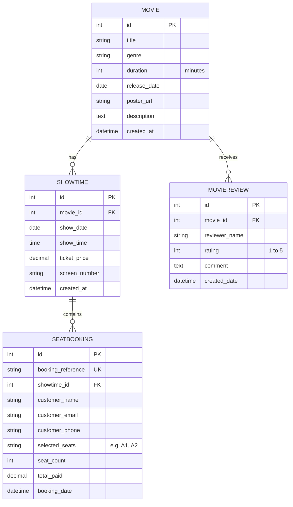

# CineSphere - Movie Ticket Booking & Community Review Portal


**CineSphere** is a cinema-style web application built with **Python 3.11+**, **Django 6.x**, **SQLite ORM**, and **Bootstrap 5**. It features an interactive **5 × 8 cinema seat-selection grid**, dynamic real-time ticket price calculations, server-side duplicate booking prevention, community ratings and reviews, an administrative management panel, and turnkey deployment readiness for **GitHub** and **Render**.

---

## Table of Contents
1. [Core Features](#1-core-features)
2. [Technology Stack](#2-technology-stack)
3. [Project Structure](#3-project-structure)
4. [Database Models](#4-database-models)
5. [Local Quickstart & Setup](#5-local-quickstart--setup)
6. [Administrator Account & Admin Panel](#6-administrator-account--admin-panel)
7. [Testing the Application](#7-testing-the-application)
8. [Interactive 5 × 8 Seat Grid Details](#8-interactive-5--8-seat-grid-details)
9. [Deployment to GitHub and Render](#9-deployment-to-github-and-render)
10. [Render Ephemeral SQLite Note](#10-render-ephemeral-sqlite-note)
11. [Troubleshooting Common Issues](#11-troubleshooting-common-issues)

---

## 1. Core Features

### Modern Cinema-Themed Homepage
- **Dark Cinematic Visuals**: Sleek midnight theme with glowing amber/gold accents (`#FFB703`) and glassmorphic card designs.
- **Hero Spotlight**: Featured premiere movie with synopsis, ratings badge, and direct call-to-action buttons.
- **Search & Genre Filtering**: Instant keyword search (by title, description, or genre) and responsive genre filter pills (Sci-Fi, Action, Animation, Thriller, Drama, Fantasy).
- **Portal Statistics**: Live metrics displaying active movies, daily screenings, and community reviews.

### Movie Details & Showtimes
- **Full Movie Overview**: High-resolution poster backdrop, genre badge, duration (e.g., `2h 28m`), and official release date.
- **Date-Grouped Showtimes**: Showtimes organized chronologically with screen designations (IMAX 70mm, Dolby Cinema, Laser 4K), ticket prices, and real-time seat availability counters.
- **Community Rating Showcase**: Average star score computed dynamically from all verified viewer reviews.

### Interactive 5 × 8 Seat Selection & Booking
- **Visual Cinema Layout**: Authentic 5 rows (Rows A to E) by 8 columns (Cols 1 to 8) containing 40 total seats, with a center aisle between columns 4 and 5.
- **Front Screen Visualization**: Curved glowing cinema screen bar indicating orientation.
- **Color-Coded Statuses**:
  - **Available**: Dark slate seat with subtle border and interactive hover scale.
  - **Selected**: Glowing golden badge with pop animation and ticket icon.
  - **Already Booked**: Crimson/dark red seat marked with `✕` and disabled.
- **Real-Time Client Calculations**: Dynamically updates selected seat codes, ticket count, and total cost (`count × unit_price`).
- **Server-Side Validation**:
  - Re-checks seat availability inside a database transaction (`transaction.atomic()`) to prevent race conditions and duplicate bookings.
  - Enforces seat code validation (`^[A-E][1-8]$`) and requires non-empty selections.
- **Cinema E-Ticket Confirmation**: Perforated ticket receipt complete with booking reference (`#CNM-XXXXXXXX`), reserved seats, total amount paid, simulated barcode, and print/save functionality.

### Community Reviews & Ratings
- **Star Rating Selector**: 1 to 5 star rating widget with interactive hover highlights.
- **Server Validation**: Restricts ratings strictly between 1 and 5.
- **Community Hub**: Dedicated reviews page with filtering by movie and recent review streams.

### Django Admin Suite (`/admin/`)
- Pre-registered models with search fields, list filters, custom column displays, and action hierarchies for managing movies, showtimes, bookings, and reviews.

---

## 2. Technology Stack

| Layer | Technology |
|---|---|
| **Backend** | Python 3.11+ / 3.14, Django 6.1.2 |
| **Frontend** | HTML5, CSS3, JavaScript (ES6+), Bootstrap 5.3.3, Bootstrap Icons 1.11.3 |
| **Database** | SQLite (`db.sqlite3`) with Django ORM |
| **Static Serving** | WhiteNoise 6.12.0 (with compressed manifest storage) |
| **Production WSGI**| Gunicorn 21.2.0 |
| **Deployment** | Render Web Service via `render.yaml` & `build.sh` |

---

## 3. Project Structure

```
movie-booking-review/
├── manage.py                          # Django CLI entrypoint
├── requirements.txt                   # Production dependencies
├── render.yaml                        # Render Blueprint specification
├── build.sh                           # Render automated build script
├── .gitignore                         # Git exclusion rules
├── README.md                          # Complete project documentation
├── db.sqlite3                         # Local SQLite database
│
├── cinema_project/                    # Django project core configuration
│   ├── __init__.py
│   ├── settings.py                    # Environment-driven settings + WhiteNoise
│   ├── urls.py                        # Root URL dispatcher
│   ├── wsgi.py                        # WSGI entrypoint for Gunicorn
│   └── asgi.py                        # ASGI entrypoint
│
├── movies/                            # Cinema application
│   ├── __init__.py
│   ├── admin.py                       # Enhanced ModelAdmin configurations
│   ├── apps.py                        # App configuration
│   ├── forms.py                       # SeatBookingForm and MovieReviewForm
│   ├── models.py                      # Movie, Showtime, SeatBooking, MovieReview
│   ├── tests.py                       # Comprehensive unit and integration test suite
│   ├── urls.py                        # Application URL routing
│   ├── views.py                       # Views for home, booking, detail, reviews
│   ├── migrations/                    # Database migrations
│   │   ├── 0001_initial.py
│   │   └── __init__.py
│   └── management/                    # Custom management commands
│       └── commands/
│           ├── __init__.py
│           └── load_sample_data.py    # Generates realistic cinema test data
│
├── static/                            # Static assets
│   ├── css/
│   │   └── style.css                  # Custom cinema dark theme & animations
│   └── js/
│       ├── booking.js                 # 5x8 interactive seat grid & price calculator
│       └── main.js                    # Star rating picker, alerts, ticket print
│
└── templates/                         # HTML templates
    ├── base.html                      # Global layout, navbar, footer, alert messages
    └── movies/
        ├── home.html                  # Cinema homepage with hero & movie cards
        ├── movie_list.html            # Catalog with sorting and filters
        ├── movie_detail.html          # Synopsis, showtimes by date, inline review
        ├── seat_booking.html          # Interactive 5x8 seat selection page
        ├── booking_confirmation.html  # Cinema e-ticket receipt
        ├── reviews.html               # Community reviews hub
        └── add_review.html            # Review submission form
```

---

## 4. Database Models



---

## 5. Local Quickstart & Setup

Follow these steps to run the application on your computer:

### Step 1: Open Terminal in the Project Directory
```bash
cd movie-booking-review
```

### Step 2: (Optional) Create and Activate a Virtual Environment
```bash
# Windows
python -m venv venv
venv\Scripts\activate

# macOS / Linux
python3 -m venv venv
source venv/bin/activate
```

### Step 3: Install Required Dependencies
```bash
pip install -r requirements.txt
```

### Step 4: Apply Database Migrations
```bash
python manage.py migrate
```

### Step 5: Load Sample Movies, Showtimes, Reviews & Bookings
Populate the database with realistic sample cinema data using the custom management command:
```bash
python manage.py load_sample_data
```
Output:
```
Clearing existing cinema data...
Creating sample movies...
Creating showtimes for today and upcoming dates...
Creating community reviews...
Creating sample seat bookings...
Successfully loaded 6 movies, 48 showtimes, 9 reviews, and 3 sample bookings.
```

### Step 6: Start the Development Server
```bash
python manage.py runserver
```

Open your browser and navigate to:
**http://127.0.0.1:8000/**

---

## 6. Administrator Account & Admin Panel

A default administrator account has been provisioned:
- **Username**: `admin`
- **Password**: `admin12345`
- **Admin URL**: `http://127.0.0.1:8000/admin/`

### Creating a New Administrator Account
To create your own custom superuser account, run:
```bash
python manage.py createsuperuser
```
Follow the interactive prompts to enter your username, email, and password.

---

## 7. Testing the Application

### Automated Test Suite
Run the 7 automated unit and integration tests:
```bash
python manage.py test
```

Expected output:
```
Found 7 test(s).
Creating test database for alias 'default'...
.......
----------------------------------------------------------------------
Ran 7 tests in 0.210s

OK
Destroying test database for alias 'default'...
```

### Manual Testing Walkthrough

1. **Browsing & Filtering**:
   - Visit `http://127.0.0.1:8000/`.
   - Click genre pills (e.g., *Sci-Fi*, *Action*, *Animation*) to filter films.
   - Enter a keyword in the search bar (e.g., `Starlight` or `Neo-Tokyo`) and press Enter.

2. **Viewing Movie Details & Showtimes**:
   - Click on any movie card (e.g., *Starlight Odyssey*).
   - Review the synopsis, duration, and community rating.
   - Browse scheduled screenings grouped by date.

3. **Reserving Seats (Interactive 5 × 8 Grid)**:
   - Click **Select Seats** on any showtime card.
   - Observe the 5x8 grid with curved screen indicator. Pre-booked seats from sample data appear in crimson/red with `✕` marks.
   - Click two available seats (e.g., `B3` and `B4`).
   - Notice that the sidebar updates in real time:
     - Selected seat badges appear.
     - Seat count changes to `2`.
     - Total price updates automatically (e.g., `2 × $14.50 = $29.00`).
   - Fill in your Name, Email, and Phone.
   - Click **Book Seats**.

4. **Viewing E-Ticket Confirmation**:
   - You will be redirected to the confirmation page displaying your ticket stub, unique reference `#CNM-...`, and barcode.
   - Click **Print / Save Ticket** to test the browser print layout.

5. **Submitting a Community Review**:
   - Navigate to the movie detail page or click **Rate This Movie**.
   - Select 1 to 5 stars using the interactive star picker.
   - Submit your name and comment.
   - Verify that your review is immediately added and the movie's average score recalculates.

6. **Managing Data in Django Admin**:
   - Log in at `http://127.0.0.1:8000/admin/` using `admin` / `admin12345`.
   - Add new movies or adjust showtime ticket prices.

---

## 8. Interactive 5 × 8 Seat Grid Details

The cinema seating map is arranged as follows:

```
                  ======================================
                  |      FRONT CINEMA SCREEN (IMAX)    |
                  ======================================

          [Col 1] [Col 2] [Col 3] [Col 4]   (AISLE)   [Col 5] [Col 6] [Col 7] [Col 8]
  Row A     A1      A2      A3      A4                  A5      A6      A7      A8
  Row B     B1      B2      B3      B4                  B5      B6      B7      B8
  Row C     C1      C2      C3      C4                  C5      C6      C7      C8
  Row D     D1      D2      D3      D4                  D5      D6      D7      D8
  Row E     E1      E2      E3      E4                  E5      E6      E7      E8
```

- Total capacity: 40 seats.
- Bookings store normalized seat strings (e.g., `A3, A4`).
- Duplicate bookings are prevented both client-side (disabled DOM elements) and server-side (database transaction re-check).

---

## 9. Deployment to GitHub and Render

### A. Pushing to GitHub

1. Initialize git in your local directory (if not already initialized):
   ```bash
   git init
   git add .
   git commit -m "Initial commit: CineSphere movie booking & review portal"
   ```
2. Create a new repository on [GitHub](https://github.com/new).
3. Push your code:
   ```bash
   git remote add origin https://github.com/<your-username>/<your-repo-name>.git
   git branch -M main
   git push -u origin main
   ```

### B. Deploying on Render

The repository includes both `render.yaml` and `build.sh` for one-click or blueprint deployment:

#### Method 1: Deploy with Blueprint (Recommended)
1. Sign in to your [Render Dashboard](https://dashboard.render.com/).
2. Click **New +** -> **Blueprint**.
3. Connect your GitHub repository.
4. Render will detect `render.yaml` automatically and configure:
   - **Build Command**: `./build.sh`
   - **Start Command**: `gunicorn cinema_project.wsgi:application`
   - **Environment Variables**: Automatic `SECRET_KEY`, `DEBUG=False`, `ALLOWED_HOSTS=.onrender.com`.
5. Click **Apply**. Render will run `build.sh`, run migrations, collect static files with WhiteNoise, load sample data, and launch Gunicorn.

#### Method 2: Manual Web Service Setup on Render
1. Click **New +** -> **Web Service**.
2. Connect your GitHub repository.
3. Configure settings:
   - **Environment**: `Python 3`
   - **Build Command**: `./build.sh` (or `pip install -r requirements.txt && python manage.py collectstatic --no-input && python manage.py migrate && python manage.py load_sample_data`)
   - **Start Command**: `gunicorn cinema_project.wsgi:application`
4. In **Environment Variables**, add:
   - `PYTHON_VERSION`: `3.11.8`
   - `DEBUG`: `False`
   - `SECRET_KEY`: `<generate-a-secure-secret-key>`
   - `ALLOWED_HOSTS`: `.onrender.com`
5. Click **Create Web Service**.

---

## 10. Render Ephemeral SQLite Note

> [!WARNING]
> **Ephemeral Filesystem on Free Tier**: Render's free tier uses an ephemeral disk. This means any changes written to `db.sqlite3` (such as new bookings or user reviews created after deployment) will be reset whenever Render restarts, sleeps due to inactivity, or redeploys the service.
> 
> Because `build.sh` automatically executes `python manage.py load_sample_data` during every build, your deployed site will always start with fresh, fully functional sample movies, showtimes, reviews, and bookings.

---

## 11. Troubleshooting Common Issues

### 1. Port 8000 already in use
If `python manage.py runserver` fails because port 8000 is occupied:
```bash
python manage.py runserver 8080
```
Then visit `http://127.0.0.1:8080/`.

### 2. Static files not showing properly
Run:
```bash
python manage.py collectstatic --no-input
```
WhiteNoise is configured in `settings.py` with `CompressedStaticFilesStorage` to serve CSS and JavaScript reliably in both development and production.

### 3. Duplicate Seat Booking Error
If you receive the error *"Seat(s) XX were just booked by another customer"*, another user or tab has already reserved that seat. Select an unreserved seat from the grid.

### 4. CSRF Verification Failed
Ensure you access the site via the configured `ALLOWED_HOSTS` or `CSRF_TRUSTED_ORIGINS` (`http://localhost:8000` or `http://127.0.0.1:8000`). Django CSRF tokens are included on all POST forms.

---

## License & Credits
Built for cinema enthusiasts. Powered by Django, Bootstrap 5, WhiteNoise, and Gunicorn.
